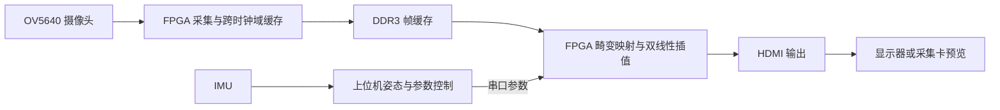

# C129 FPGA 任意角度畸变矫正系统

基于紫光同创 PGL50H 的实时图像畸变矫正装置，用于 2026 全国大学生嵌入式芯片与系统设计竞赛 FPGA 创新设计赛道「紫光同创选题二」。

系统由 OV5640 鱼眼摄像头、FPGA、DDR3、IMU、HDMI 显示/采集设备和上位机组成。FPGA 执行坐标映射、图像取样、双线性插值和输出，上位机提供参数管理、姿态控制、预览、拍照录像与指标展示。

## 原理



图像采用反向映射：输出像素经内参归一化和姿态变换，再通过 C97 镜头模型计算原图坐标，由 FPGA 读取邻近像素并插值。C97 使用 OpenCV fisheye 四系数和独立联合切向修正。映射表在 FPGA 内生成；定点流水线、分块缓存和 DDR3 调度支撑连续视频处理。

支持原图、普通矫正、IMU 动态矫正、平面扫描和自适应增强。增强模块根据亮度分布调整 Gamma，并提供细节增强。完整三轴模式的上位机预览保持原来的 100% 视野。

## 核心指标

| 项目 | 结果 |
|---|---|
| 视频处理分辨率 | 1280×720 |
| 板端新矫正帧率 | 30 fps；IMU 模式所选计数区间 160 s |
| 原图 / 矫正后整体直线度 RMS | 2.201 / 0.282 px |
| 原图 / 矫正后近似 MTF50 | 0.3468 / 0.3269 cycles/pixel |
| 普通矫正首像素延迟 P50 / P95 | 71.902 / 71.955 ms |
| 普通矫正整帧输出完成延迟 P50 / P95 | 87.899 / 87.952 ms |
| 增强模式首像素延迟 P50 / P95 | 70.496 / 71.5585 ms |
| LUT | 30,263 / 42,800（70.71%） |
| FF | 34,299 / 64,200（53.43%） |
| APM | 79.5 / 84（94.64%） |
| DRM | 92 / 134（68.66%） |
| PDS 慢角 Setup / Hold 最差裕量 | +0.203 / +0.051 ns |

画质数据来自 2026-11-02 图卡测试：每张网格统计 40 条线；MTF50 取两张图共有的 6 条有效边中位数。帧率和延迟来自 2026-11-03 板端日志，延迟边界为 FPGA 首个输入像素到同源帧输出，普通矫正 69 个样本、增强模式 1356 个样本。此次日志导出缺少结束时的主机串口解析计数，原始记录和统计范围均保留。

HDMI 约 60 Hz 刷新、上位机姿态输出确认约 18.96 次/秒，与 30 fps 新矫正帧率分别统计。完整分析见 [性能分析报告](docs/性能分析报告.txt)。

## 装置使用

1. 连接摄像头、IMU、FPGA 和 HDMI 显示或采集设备，将串口接入电脑。
2. 使用 PDS 下载 [C129_720p_cmos1.sbit](C129_compiled_final_20261031/C129_720p_cmos1.sbit)。
3. 安装带 tkinter 的 Python 3.10 或更高版本。在 `C129_compiled_final_20261031` 目录执行依赖安装：

   ```powershell
   powershell -NoProfile -ExecutionPolicy Bypass -File .\host\setup_host.ps1 -Python python
   ```

4. 双击 `start_demo.cmd`，选择 FPGA 串口、IMU 串口及视频设备，应用相机标定参数并按装置实际安装关系设置 IMU。
5. 打开预览，切换原图、普通矫正及增强模式。动态演示时记录参考姿态，再同步转动摄像头和 IMU。
6. F8 拍照保存 PNG；F9 开始或停止录像；实测指标页可以采集并导出记录。

## 工程与数据

| 内容 | 位置 |
|---|---|
| PDS 主工程 | [camera_board50.pds](C129_compiled_final_20261031/fpga_reference/project/board/build_cmos1/camera_board50.pds) |
| 时序与引脚约束 | [camera_board50_top.fdc](C129_compiled_final_20261031/fpga_reference/project/board/build_cmos1/camera_board50_top.fdc) |
| FPGA 实际编译源码与 IP | [source/rtl](C129_compiled_final_20261031/fpga_reference/project/board/build_cmos1/source/rtl) |
| 上位机 | [host](C129_compiled_final_20261031/host) |
| 标定参数 | [calibration](C129_compiled_final_20261031/host/calibration) |
| PDS 构建、资源和时序依据 | [output/c129](C129_compiled_final_20261031/fpga_reference/project/output/c129) |
| 运行实测数据索引 | [demo_evidence](C129_compiled_final_20261031/host/results/demo_evidence) |
| 原图、画质报告及复核程序索引 | [原始指标资料](原始指标资料) |
| 原交付完整性检查程序 | [verify_package.py](verify_package.py) |

工具版本 PDS 2022.2-SP6.4；器件 PGL50H / FBG484 / -6。主工程 132 项输入引用均完整，构建记录中的 228 个输入文件和 9 个产物哈希均匹配。本次补充项目说明和整机性能分析。

完整交付归档 `最终版本_代码与全部数据文件.zip` 保留所有原始代码和数据，包括 4 份超过 100 MiB 的运行日志。这 4 份日志保存在完整归档中，不写入 Git 文件历史。`verify_package.py` 用于校验完整归档解压后的原始文件。

完整归档的发布位置：[Releases](https://github.com/Yuehuan111/C129-FPGA-Vision/releases)。仓库提供可直接浏览的源码、参数、位流、画质样本和性能说明；完整归档另保留所有原始日志、历史标定图、原始资料 ZIP 及编译数据库。
